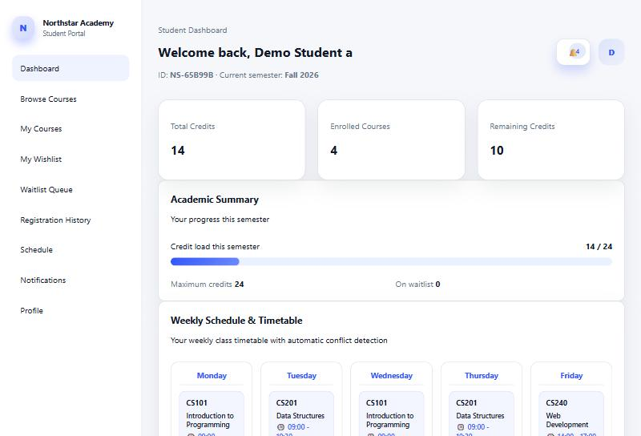
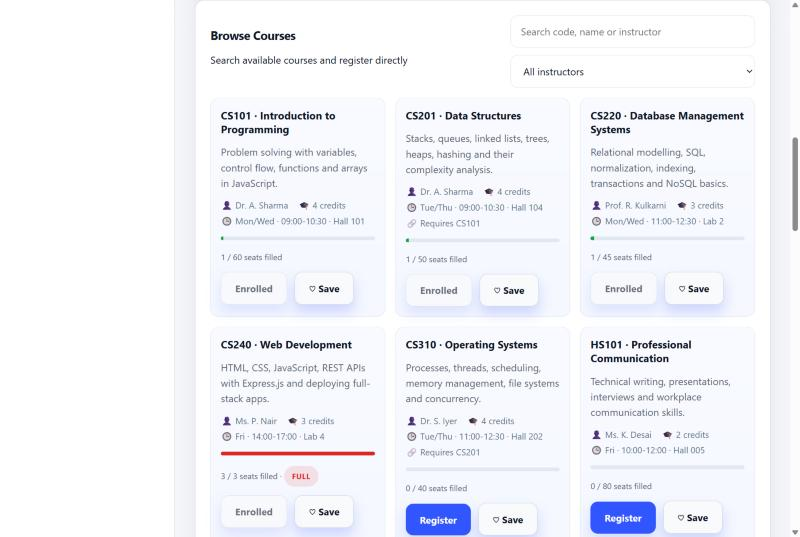
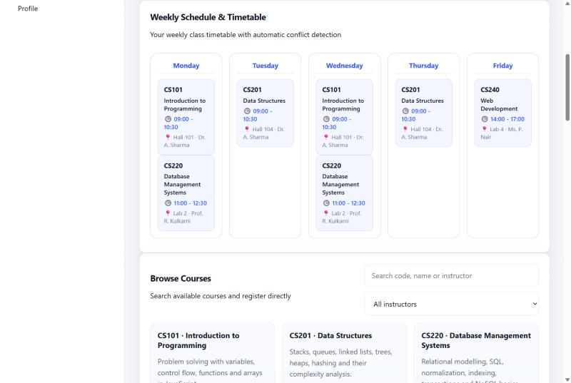
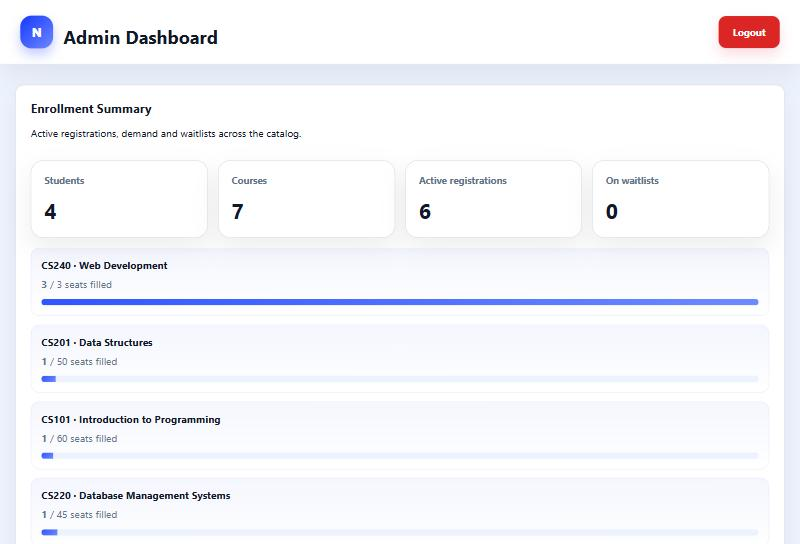

# Student Course Registration Portal


A full-stack course registration system for a college: students browse the catalog and register for courses, and admins manage courses and track enrollment. The server enforces the same rules a real registrar would: seat capacity, credit limits, prerequisites, timetable clashes, and an automatic waitlist.

**Stack:** Node.js · Express 5 · MongoDB (Mongoose) · JWT · bcrypt · express-validator · Helmet · vanilla JavaScript/HTML/CSS · Jest + Supertest



## Features

**Students**
- Sign up and log in with JWT authentication (passwords hashed with bcrypt)
- Browse and search the catalog, with live seat counts and prerequisite info
- Register and drop courses. Every registration is checked against:
  - **Capacity**: no overbooking
  - **Credit limit**: 24 credits per semester by default
  - **Prerequisites**: must be completed or taken in the same semester
  - **Schedule conflicts**: overlapping class times on the same day are rejected
  - **Course status**: closed or inactive courses can't be joined
- **Waitlist**: join when a course is full; when a seat opens, the first student in line is enrolled automatically and the queue is renumbered
- Wishlist, weekly timetable, activity feed and full registration history

**Admins**
- Create, edit and delete courses, including schedule, department, prerequisites and status
- Dashboard with active registrations, waitlist totals and the most in-demand courses
- View every student's current credit load
- Mark registrations as completed, so they count toward prerequisites

**Security and quality**
- Role-based access control (`student` / `admin`). Public sign-up can never create an admin.
- Input validation on every write endpoint, returning field-level error messages
- User input is escaped before it's used in search regexes (no ReDoS or 500s), and before it's rendered in the browser (no stored XSS)
- Helmet security headers, rate limiting on login and sign-up, and no hardcoded JWT secret
- 35 integration tests with Jest, Supertest and an in-memory MongoDB, run in CI on every push

| Browse courses | Weekly timetable |
| --- | --- |
|  |  |



## Getting started

Prerequisites: Node.js 20+ and MongoDB running locally (or a MongoDB Atlas connection string).

```bash
git clone https://github.com/paraspatil1107/Student-Registration-Portal.git
cd Student-Registration-Portal
npm install
cp .env.example .env      # then set JWT_SECRET to a long random string
npm run seed              # creates the admin account and sample courses
npm run dev               # http://localhost:3000
```

Demo admin after seeding: `admin@college.edu` / `Admin@123`. Change it with `ADMIN_EMAIL` / `ADMIN_PASSWORD` in `.env` before seeding. Students sign up from the Register page.

### Tests

```bash
npm test               # 35 API tests against an in-memory MongoDB
npm run test:coverage
```

## API

All routes are under `/api`. Protected routes need `Authorization: Bearer <token>`.

| Method | Route | Access | Description |
| --- | --- | --- | --- |
| POST | `/auth/register` | Public | Create a student account |
| POST | `/auth/login` | Public | Log in and receive a JWT |
| GET | `/auth/me` | Logged in | Current user's profile |
| GET | `/courses?search=&filter=` | Public | List courses with `enrolledCount` and `seatsLeft` |
| GET | `/courses/:id` | Public | Course details |
| POST | `/courses` | Admin | Create a course |
| PUT | `/courses/:id` | Admin | Update a course |
| DELETE | `/courses/:id` | Admin | Delete a course and its related records |
| POST | `/registrations` | Student | Register for a course `{ courseId }` |
| GET | `/registrations/my-courses` | Student | Current courses and total credits |
| GET | `/registrations/history` | Student | All registrations, drops and completions |
| DELETE | `/registrations/:courseId` | Student | Drop a course (promotes the next waitlisted student) |
| POST | `/waitlist` | Student | Join a full course's waitlist |
| GET | `/waitlist/my-waitlist` | Student | My waitlist positions |
| DELETE | `/waitlist/:courseId` | Student | Leave a waitlist |
| POST / GET / DELETE | `/wishlist` | Student | Manage saved courses |
| GET | `/admin/dashboard` | Admin | Enrollment statistics |
| GET | `/admin/students` | Admin | Students with their current load |
| GET | `/admin/registrations` | Admin | All registrations |
| PATCH | `/admin/registrations/:id` | Admin | Set status to `registered`, `dropped` or `completed` |

Validation errors return `400` with `{ message, errors: [{ field, message }] }`.

## Project structure

```
server.js                 # loads env, connects to MongoDB, starts the server
src/
  app.js                  # Express app: middleware and routes (imported by the tests)
  config/db.js
  controllers/            # auth, course, registration, waitlist, wishlist, admin
  middleware/             # JWT auth + roles, validation rules, error handler
  models/                 # User, Course, Registration, Waitlist, Wishlist
  routes/
  utils/
public/                   # static frontend (HTML, CSS, vanilla JS)
scripts/seedAdmin.js      # admin account + sample catalog
tests/                    # Jest + Supertest integration tests
```
